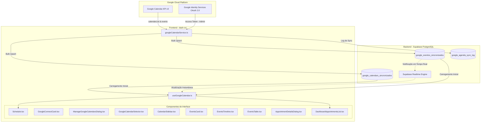

# 📅 Integração Direta com Google Calendar API v3

Este documento descreve a arquitetura, funcionalidades, regras de negócio e configuração do módulo de **Agenda & Atendimentos Veterinários** (`/schedule`) integrado diretamente com a API v3 do Google Agenda.

---

## 📌 1. Visão Geral

O módulo foi concebido para fornecer uma central de **consulta, visualização e acompanhamento operacional em tempo real** para veterinários, recepcionistas e administradores da clínica.

### Diretrizes de Projeto:
- **Integração Direta**: Conexão nativa com a API v3 do Google Calendar via Google Identity Services (sem intermediários como n8n para a leitura).
- **Sem CRUD no Dashboard**: Operação estritamente de consulta (somente leitura), eliminando riscos de exclusão ou alteração acidental de agendamentos no painel.
- **Sem Conceitos Artificiais de Status**: Não há abas ou badges de "confirmados" ou "pendentes". A interface apresenta com fidelidade os agendamentos reais existentes na conta Google.
- **Agendas Reais da Clínica**: Os calendários exibidos vêm dinamicamente da conta Google do estabelecimento com suas cores oficiais, identificando salas, veterinários, especialidades ou procedimentos.

---

## ⚙️ 2. Arquitetura Técnica

### 2.1 Credenciais e Autenticação
- **Client ID**: `450283204287-d0slgm6cmfkh5lcm1burag79r483h53i.apps.googleusercontent.com`
- **Escopos Utilizados**:
  - `https://www.googleapis.com/auth/calendar.readonly`
  - `https://www.googleapis.com/auth/calendar.events.readonly`
- **Origens JavaScript Autorizadas (Google Cloud Console)**:
  - `https://vetbots.com.br` (Produção)
  - `http://localhost:8080` (Desenvolvimento local)
  - `http://localhost`

### 2.2 Parser Inteligente de Dados Clínicos
O serviço `googleCalendarService.ts` analisa o sumário e a descrição dos eventos para extrair automaticamente metadados clínicos úteis:
- **Nome do Pet**: Identificado por padrões comuns (`Paciente: [Nome]`, `Pet: [Nome]`, ou formato `[Nome do Pet] - [Procedimento]`).
- **Nome do Tutor**: Detectado por marcações (`Tutor: [Nome]`, `Cliente: [Nome]`, ou participantes/attendees).
- **Telefone**: Regex para números brasileiros com DDD (ex: `(11) 98765-4321` ou `11987654321`).
- **Observações Clínicas**: Preservadas e formatadas com quebras de linha limpas.

---

## 🖥️ 3. Funcionalidades da Interface

### 3.1 Gerenciamento de Agendas (Sincronizadas vs. Não Sincronizadas)
- O botão **"Gerenciar Agendas"** abre o modal `ManageGoogleCalendarsDialog.tsx`.
- Divide os calendários da conta em duas abas:
  1. **Disponíveis para Sincronizar**: Mostra agendas da conta Google que ainda não foram adicionadas ao dashboard, com botão `+ Sincronizar` para ativação imediata.
  2. **Agendas Sincronizadas**: Exibe as agendas ativas que alimentam o painel, permitindo pausar/remover qualquer uma com 1 clique.
- A lista de IDs de agendas ativas é persistida no navegador (`localStorage: dash_enabled_google_calendars`).

### 3.2 Dupla Forma de Filtragem por Agenda
O usuário possui duas maneiras complementares e 100% sincronizadas de filtrar os calendários:
1. **Badges Visuais no Topo** (`GoogleCalendarSelector.tsx`):
   - Botões horizontais com a cor nativa de cada calendário no Google, nome e contador de atendimentos.
2. **Dropdown Select na Barra de Ferramentas** (`EventsCard.tsx`):
   - Menu suspenso compacto ao lado do campo de busca, ideal para navegação rápida ou telas menores.
- Alterar uma opção atualiza a outra instantaneamente.

### 3.3 Calendário Lateral Retrátil (Tela Cheia)
- O mini calendário lateral (`CalendarSidebar.tsx`) pode ser recolhido a qualquer momento:
  - Botão de seta recolher no cabeçalho do calendário.
  - Botão **"Recolher Calendário / Ver Calendário"** na barra de ações.
- **Expansão Dinâmica**: Ao recolher o calendário, o grid de agendamentos expande para **largura total (12 colunas)**, oferecendo visualização máxima em monitores e tablets.
- O estado aberto/fechado é salvo automaticamente em `localStorage: dash_calendar_sidebar_open`.

### 3.4 Flag para Ocultar Bloqueios de Agenda
- As clínicas veterinárias frequentemente criam eventos no Google Calendar com títulos como *"Bloqueio"*, *"bloqueio de agenda"*, *"Bloqueio almoço"*, etc.
- Foi implementada uma flag interativa com **Switch e ícone `Ban`** na barra de filtros:
  - **Filtro Case-Insensitive**: Oculta automaticamente qualquer evento cujo título contenha a palavra "bloqueio".
  - **Contador em Tempo Real**: Exibe a quantidade de bloqueios filtrados (ex: `Ocultar bloqueios (3)`).
  - **Ativado por Padrão**: A flag vem ligada para priorizar clientes reais e salva a preferência em `localStorage: dash_hide_calendar_blocks`.
  - Os contadores de atendimentos recalculam dinamicamente sem os bloqueios.

### 3.5 Alternância de Modos de Visualização
- **Cards / Linha do Tempo** (`EventsTimeline.tsx`):
  - Agrupa os atendimentos em turnos clínicos: **Manhã** (antes das 12h), **Tarde** (12h às 18h) e **Noite** (após as 18h).
  - Destaque visual com cor da agenda, horário, paciente, tutor e observações.
- **Tabela Operacional** (`EventsTable.tsx`):
  - Visão tabular compacta com colunas de Horário, Agenda de Origem, Procedimento, Paciente/Tutor e Ações.
- **Botão de Impressão**: Permite à recepção imprimir a listagem do dia em 1 clique.

### 3.6 Modal de Ficha Rápida do Atendimento
- Clicar em qualquer agendamento abre o `AppointmentDetailsDialog.tsx` (somente leitura):
  - Procedimento e data formatada por extenso.
  - Badge colorido da agenda Google de origem.
  - Horário de início e fim.
  - Nome do paciente (pet) com ícone de pata.
  - Nome do tutor com ícone de cliente.
  - Telefone com botão para **copiar para a área de transferência**.
  - E-mail e localização.
  - Observações clínicas e sintomas informados.
  - Botão direto para **"Abrir no Google Agenda"**.

### 3.7 Widget na Tela Inicial (`Dashboard.tsx`)
- O componente `DashboardAppointmentsList.tsx` consome os mesmos dados do hook `useGoogleCalendar`:
  - Mostra os próximos agendamentos de hoje logo na página principal.
  - Aplica automaticamente o filtro de bloqueios.
  - Atalho direto para abrir a agenda completa.

---

## 📁 4. Estrutura de Arquivos

| Arquivo | Função Principal |
|---|---|
| `src/types/calendar.ts` | Definições de tipos TypeScript (`GoogleCalendar`, `CalendarEvent`, `CalendarAttendee`). |
| `src/services/googleCalendarService.ts` | Cliente da API v3 do Google (GIS OAuth, `calendarList`, `events`, parser de texto e cache). |
| `src/hooks/useGoogleCalendar.ts` | Hook React com gerenciamento de conexão, sincronização, seleção e persistência. |
| `src/pages/Schedule.tsx` | Página principal com cabeçalho, métricas limpas, alternância retrátil e modais. |
| `src/components/schedule/GoogleConnectCard.tsx` | Card de conexão OAuth, status da sincronização e atalho para gerenciar agendas. |
| `src/components/schedule/GoogleCalendarSelector.tsx` | Seletor horizontal de agendas por badges/chips com cores nativas do Google. |
| `src/components/schedule/ManageGoogleCalendarsDialog.tsx` | Modal para visualizar agendas não sincronizadas vs. sincronizadas e ativá-las. |
| `src/components/schedule/CalendarSidebar.tsx` | Mini calendário lateral com atalhos de data e botão de recolhimento. |
| `src/components/schedule/EventsCard.tsx` | Barra de busca, dropdown select de agendas, switch de bloqueios e alternador cards/tabela. |
| `src/components/schedule/EventsTimeline.tsx` | Visualização em cards agrupados por turnos (Manhã, Tarde, Noite). |
| `src/components/schedule/EventsTable.tsx` | Visualização em tabela compacta e responsiva com link do Google Calendar. |
| `src/components/schedule/AppointmentDetailsDialog.tsx` | Modal com ficha clínica completa do agendamento (somente leitura). |
| `src/components/schedule/DashboardAppointmentsList.tsx` | Widget de agendamentos de hoje na página inicial do dashboard. |

---

## 🔐 5. Guia de Configuração no Google Cloud Console

Para autorizar novos domínios ou portas de desenvolvimento:

1. Acesse o [Google Cloud Console - Credenciais](https://console.cloud.google.com/apis/credentials).
2. Selecione o projeto `cvi-500810`.
3. Clique no cliente OAuth 2.0 Web correspondente.
4. Na seção **"Origens JavaScript autorizadas"** (*Authorized JavaScript origins*), certifique-se de registrar:
   - `http://localhost:8080`
   - `http://localhost`
   - `https://vetbots.com.br`
   *(Atenção: nunca adicione barra `/` ao final das URLs).*
5. Salve as alterações e aguarde cerca de 1 a 2 minutos para propagação global.

---

## 💡 6. Dicas de Uso Operacional

- **Primeiro Acesso**: O administrador clica em *"Conectar Google Agenda"* no topo da página `/schedule` e autoriza a conta Google da clínica.
- **Adicionar Novas Agendas**: Se uma nova sala ou veterinário for criado no Google Calendar, clique em *"Gerenciar Agendas"* > aba *"Disponíveis para Sincronizar"* e clique em `+ Sincronizar`.
- **Modo Cirurgia / Foco**: Recolha o calendário lateral usando o botão *"Recolher Calendário"* para ter a visualização dos cards ocupando toda a tela.
- **Visualizar Bloqueios**: Se a recepção precisar conferir horários bloqueados da clínica, basta desmarcar o switch *"Ocultar bloqueios"*.
